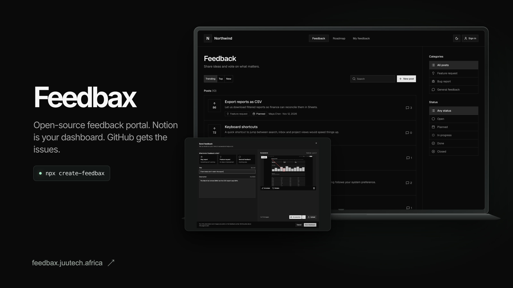

# Feedbax

A self-hosted feedback portal: collect ideas, votes and comments, triage in Notion, and turn approved posts into GitHub issues.

[](https://www.npmjs.com/package/create-feedbax)
[](LICENSE)

[Try the demo](https://feedbax-demo.DEMO_SUBDOMAIN.workers.dev)

## Get started

You need **Node 24.15 or newer 24.x**, a Notion workspace where you are an **owner**, and a [free Cloudflare account](https://dash.cloudflare.com/sign-up).

1. **Duplicate the Notion template.** Sign in to Notion in your browser, then open [the Feedbax template](https://brave-number-c98.notion.site/Feedbax-418afe159691807c8805db7a942aedcc) and choose **Duplicate** into your workspace. If Duplicate is missing, check that you're signed in and reopen the link ([Notion's guide](https://www.notion.com/help/duplicate-public-pages)). You can also skip the template: setup can create a database on a page you own.

2. **Create a Notion connection and give it page access.** Open [Developer connections](https://app.notion.com/developers/connections), choose **New connection → API token**, select your workspace and copy its token. The CLI calls this your **Notion secret**. Allow reading, inserting and updating content.

   Connect it to your duplicated page (or the page where setup should create the database) using either route:

   - **On the page:** **•••** (top right) → **Connections** → search your integration → **Confirm**. In the current app, look under **Actions → More → Connections → Add connections**.
   - **From settings:** **Settings → Connections → Develop or manage integrations →** your integration → **Access** tab → **Edit access** → tick the page → **Save**. Some screens label the tab **Content access**; the developer link may open **Developer connections**.

   Select the parent page in your workspace, checking its location if names repeat. Reopen access settings to check that the page is listed, rather than **No page access**. If the page menu only shows **Connections — None**, try the settings route. [Notion's connection guide](https://www.notion.com/help/add-and-manage-connections-with-the-api) covers workspace permissions.

   **If setup says it can't see your page, the integration isn't connected yet.** Setup accepts `app.notion.com/p/…` page links too.

3. **Optional: create a GitHub token.** For the **Notion + GitHub** template, open [the token form](https://github.com/settings/personal-access-tokens/new?name=Feedbax&description=Feedbax+issue+sync&issues=write). Choose **Only select repositories**, pick your repository, and set **Issues → Read and write**. Copy the generated token. Skip this for **Notion** only.

4. **Run setup.** Choose one command:

   ```sh
   npx create-feedbax@latest
   ```

   ```sh
   pnpm dlx create-feedbax@latest
   ```

   ```sh
   bunx create-feedbax@latest
   ```

   Answer **Project name**, **Template**, **Paste your Notion secret**, the GitHub questions if selected, and **Let people post without an account?** Setup finds your database, or offers **Paste a page link** and **I just shared one — search again**. Log in to Cloudflare when the browser opens.

   R2 needs enabling once. If needed, the CLI says: “R2 isn't enabled on this account. Open https://dash.cloudflare.com/?to=/:account/r2/overview and click Enable R2 (the free tier needs a payment method on file). Press Enter when done.” It also asks **Pick your workers.dev subdomain** if you don't have one.

5. **You're live.** Setup creates storage, applies migrations and prints **Your feedback portal is live:** followed by your URL. Open it and submit a post; it should reach Notion within about 5 minutes. If setup stops, fix the reported problem and rerun the same command from the same folder. Answer yes to **Finish setting up …?** to resume.

## How it works

```text
People → Cloudflare portal → D1 (source of truth)
                               │ sync every 5 minutes
                               ▼
                         Notion dashboard
                               │ “Send to GitHub” checked
                               ▼
                           GitHub issue
```

Images live in R2. The portal keeps working during a Notion or GitHub outage; sync catches up later. Posts and images are public as soon as they're submitted.

- Change **Status** in Notion: Open, Planned, In progress, Done or Closed. **Done** means delivered; **Closed** means declined, duplicate or out of scope. Allow about 5 minutes for changes to appear.
- With GitHub enabled, tick **Send to GitHub** to create one issue. Changing Status alone creates nothing. Unticking later does nothing. Closing the issue marks the post **Done**; reopening it does not undo that.
- Keep the database's property names and types. Extra properties and views are welcome. Feedbax writes the author, counts and links; your team changes Status and Send to GitHub.

## Add the feedback dialog to your app

Let signed-in users send feedback with an annotated screenshot, without a second login. Your app needs React and shadcn/ui (CLI 4.7 or newer).

**1. Install today (works now):**

```sh
npx shadcn@latest add https://raw.githubusercontent.com/jessequartey/feedbax/main/public/r/feedbax-feedback.json
```

**Install by name:** merge this field into your app's `components.json`:

```json
{
  "registries": {
    "@feedbax": "https://raw.githubusercontent.com/jessequartey/feedbax/main/public/r/{name}.json"
  }
}
```

Then run:

```sh
npx shadcn@latest add @feedbax/feedbax-feedback
```

Once Feedbax is listed in the [shadcn registry directory](https://ui.shadcn.com/docs/registry/registry-index), the `components.json` step won't be needed. The block copies components to `components/feedbax/` and helpers to `lib/feedbax/`, using your aliases and theme.

**2. Add a token endpoint on your server.** Copy `FEEDBAX_HOST_SECRET` from the portal's `.dev.vars` into your app's server environment; keep the generated value unchanged. Keep `token.server` imports on the server only.

Adapt `getSessionUser` to your own authentication: it must read the session, never the request body, and return `{ id, name, isAnonymous }` or `null`. Set `isAnonymous` explicitly from your auth system's guest/anonymous flag; only a registered, signed-in user should return `false`. Replace `https://app.example.com` with your app's trusted origin (your localhost origin for development).

A Web handler for `POST /api/feedbax-token`:

```ts
import { mintFeedbaxToken } from "@/lib/feedbax/token.server";

const APP_ORIGIN = "https://app.example.com";

export async function POST(request: Request): Promise<Response> {
  if (request.headers.get("Origin") !== APP_ORIGIN) {
    return new Response("Forbidden", { status: 403 });
  }
  const user = await getSessionUser(request); // your own auth
  if (!user || user.isAnonymous !== false) {
    return new Response("Unauthorized", { status: 401 });
  }
  const token = await mintFeedbaxToken({
    secret: process.env.FEEDBAX_HOST_SECRET!,
    user: { id: user.id, name: user.name },
  });
  return Response.json({ token }, { headers: { "Cache-Control": "no-store" } });
}
```

Or a TanStack Start route at `src/routes/api/feedbax-token.ts`, with the same auth adapter and origin:

```ts
import { createFileRoute } from "@tanstack/react-router";
import { mintFeedbaxToken } from "@/lib/feedbax/token.server";

const APP_ORIGIN = "https://app.example.com";

export const Route = createFileRoute("/api/feedbax-token")({
  server: {
    handlers: {
      POST: async ({ request }) => {
        if (request.headers.get("Origin") !== APP_ORIGIN) {
          return new Response("Forbidden", { status: 403 });
        }
        const user = await getSessionUser(request); // your own auth
        if (!user || user.isAnonymous !== false) {
          return new Response("Unauthorized", { status: 401 });
        }
        const token = await mintFeedbaxToken({
          secret: process.env.FEEDBAX_HOST_SECRET!,
          user: { id: user.id, name: user.name },
        });
        return Response.json({ token }, { headers: { "Cache-Control": "no-store" } });
      },
    },
  },
});
```

On Cloudflare Workers, use `env.FEEDBAX_HOST_SECRET` from `import { env } from "cloudflare:workers"` instead of `process.env`.

For other backends, sign an HS256 JWT with the base64url-decoded secret. Use header `{"alg":"HS256","typ":"JWT"}` and claims `sub` (stable user ID, 1–200 characters), `name` (1–80 characters), `exp` (at most 5 minutes ahead) and `jti` (fresh UUID). Each token works once.

**3. Render the dialog and link.** The exported component is named `FeedbaxDialog`:

```tsx
import { FeedbaxDialog } from "@/components/feedbax/feedback-dialog";
import { FeedbaxLink } from "@/components/feedbax/feedbax-link";

<FeedbaxDialog portalUrl="https://feedback.example.com" />

<FeedbaxLink portalUrl="https://feedback.example.com">
  Go to feedback
</FeedbaxLink>
```

Replace the URL with your portal's. In the portal's `feedbax.config.ts`, set `appUrl` to your app's URL and redeploy. This allows your app's origin to submit and adds **Back to app**. `FeedbaxLink` opens the portal sign-in flow and then the board. Host identities and standalone portal accounts are separate; the block always requires a signed-in host user.

| `FeedbaxDialog` prop   | Default              | Purpose                                                  |
| ---------------------- | -------------------- | -------------------------------------------------------- |
| `portalUrl`            | required             | Your portal's origin                                     |
| `tokenUrl`             | `/api/feedbax-token` | Your token route                                         |
| `getToken`             | none                 | Override with `() => Promise<{ token: string }>`         |
| `trigger`              | Feedback button      | Custom element, or `null` for controlled use             |
| `redirectOnSubmit`     | `true`               | Open the new post; `false` shows a View your post button |
| `onSubmitted`          | none                 | Receives `{ postId, postUrl }`                           |
| `open`, `onOpenChange` | none                 | Controlled state                                         |

`FeedbaxLink` accepts `portalUrl`, `tokenUrl`, `getToken`, `children`, `to` (`/` or `/posts/<id>`) and `target` (`_self` or `_blank`).

**Screenshots:** the default captures the page's DOM. Cross-origin images without CORS, iframes, video and some CSS effects may look different or blank; sticky headers may shift. Mark excluded elements with `data-feedbax-ignore`. **Capture screen instead…** uses the browser's screen picker where supported. Upload, paste (⌘/Ctrl+V) and drag-and-drop also work. Capture never starts automatically or attaches your page URL. Users can annotate and hide sensitive information before sending.

## Configuration

Edit your generated `feedbax.config.ts`, then run `npm run deploy`:

```ts
import { defineConfig } from "./src/contracts/config.ts";

export default defineConfig({
  name: "My feedback",
  appUrl: "https://app.example.com", // optional: Back to app and allowed host origin
  auth: { anonymous: false }, // true allows posting, comments and votes without an account
  integrations: {
    notion: { dataSourceId: "…" }, // keep the value setup generated
    github: false, // or { repo: "owner/repo" }, with GITHUB_TOKEN set
  },
});
```

`appUrl` must be an absolute HTTPS URL (HTTP is allowed for localhost). Omit it for a standalone portal. GitHub issue sync and **Sign in with GitHub** are separate; either can be enabled independently.

| Secret or variable                         | Purpose                                                                    |
| ------------------------------------------ | -------------------------------------------------------------------------- |
| `PORTAL_URL`                               | Portal URL; setup writes this variable to `wrangler.jsonc` and `.dev.vars` |
| `BETTER_AUTH_SECRET`                       | Generated by setup                                                         |
| `FEEDBAX_HOST_SECRET`                      | Generated by setup; copy to your app's server for the dialog               |
| `NOTION_TOKEN`                             | Your Notion connection's API token                                         |
| `GITHUB_TOKEN`                             | Optional issue sync: fine-grained token, Issues read/write for one repo    |
| `GITHUB_CLIENT_ID`, `GITHUB_CLIENT_SECRET` | Optional GitHub login                                                      |
| `GOOGLE_CLIENT_ID`, `GOOGLE_CLIENT_SECRET` | Optional Google login                                                      |

Secrets live in git-ignored `.dev.vars` locally and Cloudflare secrets in production. Never put them in `VITE_*` variables or `feedbax.config.ts`. To set or rotate one in production:

```sh
npx wrangler secret put NOTION_TOKEN
```

For OAuth login, set both values of the provider's pair; an incomplete pair stops startup. Register your portal URL followed by `/api/auth/callback/github` or `/api/auth/callback/google` as the callback. Email/password login needs a 12–128 character password; there is no verification email or password reset in 0.3.0.

## Theming

Choose a preset at [shadcn Create](https://ui.shadcn.com/create). These commands use Feedbax's default preset; replace `buFyyzw` with your chosen code:

```sh
npx shadcn@latest apply --preset buFyyzw --only theme  # colors only
npx shadcn@latest apply --preset buFyyzw               # full style
```

Redeploy afterwards. The dialog follows your app's theme.

## Deploy and update

From your generated project folder:

```sh
npm run dev      # local portal at http://localhost:3000
npm run deploy   # build, migrate production database, deploy
```

Local data is separate, but local posts sync to your real Notion database if `NOTION_TOKEN` is set. Remove test rows afterwards.

For a custom domain, update the route in `wrangler.jsonc` and `PORTAL_URL` together, then deploy. Updates are source-level in 0.3.0: review and copy upstream changes into your project, keeping your config, resource IDs and secrets. Running create-feedbax again resumes setup; it does not upgrade an existing project. There is no automatic migration from 0.2.x; start a new project (see [CHANGELOG.md](CHANGELOG.md)).

**Removing a test or spam post:** there is no moderation screen in 0.3.0. Copy the post's UUID from its portal URL and inspect the matching records first:

```sh
npx wrangler d1 execute DB --remote --command "SELECT id, title, notion_page_id, github_number FROM posts WHERE id = '<post UUID>'; SELECT object_key FROM images WHERE post_id = '<post UUID>'"
```

Keep the image keys, then delete only that post and its dependent rows:

```sh
npx wrangler d1 execute DB --remote --command "DELETE FROM comments WHERE post_id = '<post UUID>'; DELETE FROM votes WHERE post_id = '<post UUID>'; DELETE FROM images WHERE post_id = '<post UUID>'; DELETE FROM posts WHERE id = '<post UUID>'"
```

Move its matching Notion row to Trash and remove any test GitHub issue separately. Deleting database rows leaves image files in R2; delete the saved keys from the project's images bucket in the Cloudflare dashboard. Use these steps for each test post while keeping real feedback.

## Free plan

Feedbax uses one Worker, one D1 database, one R2 bucket, one Queue and one of your account's five free Cron triggers. For a typical portal with 50 visitors, 5 new posts and 20 votes a day, 300 total posts and GitHub enabled:

| Daily resource   | Estimated use | Free allowance |
| ---------------- | ------------- | -------------- |
| Worker requests  | ~1.5k         | 100k           |
| D1 rows read     | ~0.4M         | 5M             |
| D1 rows written  | ~1k           | 100k           |
| Queue operations | ~1.8k         | 10k            |

That leaves at least 80% headroom on these daily limits. R2 use is a few uploads and a few thousand image reads a month, against millions free. Browser caching avoids repeat image and asset reads. Idle sync checks Notion every 5 minutes and skips GitHub when no linked issue needs checking; failures back off instead of retrying in a loop. See Cloudflare's [Workers](https://developers.cloudflare.com/workers/platform/limits/), [D1](https://developers.cloudflare.com/d1/platform/pricing/), [Queues](https://developers.cloudflare.com/queues/platform/pricing/) and [R2](https://developers.cloudflare.com/r2/pricing/) limits for your traffic.

**CPU is the tight limit:** sign-in password work and board rendering use about **6.5–7.5 ms of the 10 ms Free CPU budget in local measurements**. These are local component measurements, not complete production requests; live numbers are pending. Watch your Worker's CPU metrics and consider [Workers Paid](https://developers.cloudflare.com/workers/platform/pricing/) if requests exceed the budget. OAuth and host login avoid password hashing.

Password login uses PBKDF2-SHA256 with 50,000 iterations to fit that budget, below [OWASP's recommendation](https://cheatsheetseries.owasp.org/cheatsheets/Password_Storage_Cheat_Sheet.html#pbkdf2). Long passwords and sign-in rate limits help, but do not remove that tradeoff.

## Notifications (coming later)

Nothing to configure today. When notifications ship, you'll add an email provider key and turn them on in `feedbax.config.ts`.
Follow the [roadmap](#roadmap) for updates.

## Roadmap

These features are **Planned**. [Vote on the demo roadmap](https://feedbax-demo.DEMO_SUBDOMAIN.workers.dev/roadmap) to help prioritize them:

- Admin: manage users
- Webhooks
- Changelog & product updates
- Admin settings
- Email notifications

## Troubleshooting

Open your portal's `/api/health` for `notion` and `github` status (`ok`, `failing` or `off`). For details, run `npx wrangler tail` from your project or open Workers Logs in Cloudflare.

| Problem                                       | Fix                                                                                                                                                                                                                                   |
| --------------------------------------------- | ------------------------------------------------------------------------------------------------------------------------------------------------------------------------------------------------------------------------------------- |
| “check you copied the whole secret”           | Copy the full API token from your Notion connection, without spaces or line breaks.                                                                                                                                                   |
| Setup can't see your page/database            | Recheck both access routes in [step 2](#get-started), then choose **I just shared one — search again** or paste the page link. Search can lag. If settings still say **No page access**, ask the workspace owner to connect the page. |
| Public template missing or shows “No results” | You can continue with a blank page you own: connect it in step 2 and let setup create the database. Report the template link through [GitHub issues](https://github.com/jessequartey/feedbax/issues).                                 |
| “R2 isn't enabled on this account”            | Follow the CLI's link, click **Enable R2**, then press Enter. A payment method is required even on the free tier.                                                                                                                     |
| workers.dev subdomain fails                   | Pick another name, or follow the CLI's Workers & Pages dashboard link and press Enter when ready.                                                                                                                                     |
| Resource name already exists                  | Choose another project name; `<name>-db`, `<name>-images` and `<name>-sync` must be unused for a new project.                                                                                                                         |
| Setup stopped halfway                         | Rerun the same command and accept **Finish setting up …?** Secrets and resources are reused.                                                                                                                                          |
| GitHub repo rejected                          | Use `owner/repo`, enable Issues, unarchive the repo, and give the token Issues read/write for that repo.                                                                                                                              |
| Notion sync fails                             | Check page access and required property names/types. Restore them and wait for the next sync.                                                                                                                                         |
| No GitHub issue                               | Tick **Send to GitHub** in Notion and allow 5 minutes; check `/api/health`.                                                                                                                                                           |
| Dialog gets 401 / expired link                | Tokens last 5 minutes and work once. Retry; check that host secrets match and the server clock is correct.                                                                                                                            |
| Dialog blocked by CORS                        | Set `appUrl` to your app's exact origin and redeploy the portal.                                                                                                                                                                      |

## Community templates

Share your own Notion layout or find alternatives in [TEMPLATES.md](TEMPLATES.md).

## Contributing

Bug reports, fixes and templates are welcome. See [CONTRIBUTING.md](CONTRIBUTING.md) for local setup, checks and release instructions.

## License

[Apache-2.0](LICENSE)
