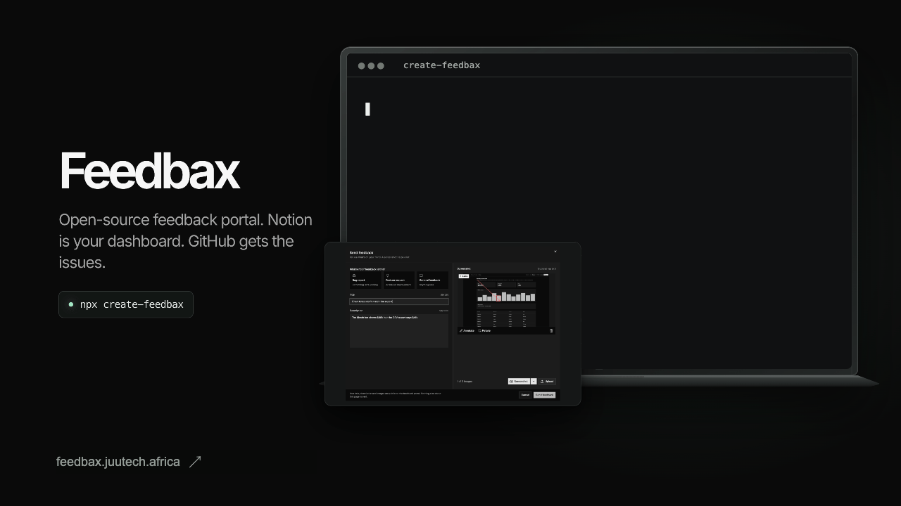

# Feedbax

A self-hosted feedback portal: collect ideas, votes and comments, triage in Notion, and turn approved posts into GitHub issues.

[](https://www.npmjs.com/package/create-feedbax)
[](LICENSE)

[Try the demo](https://feedbax.juutech.africa)

## Get started

Set up the core portal first. Add sign-in, GitHub, email and webhooks after it is live.

You need **Node 24.15 or newer 24.x**, a Notion workspace you own, and a [free Cloudflare account](https://dash.cloudflare.com/sign-up). Anonymous feedback is on. No sign-in provider is installed.

1. **Duplicate the Notion template.** Sign in to Notion, open [the Feedbax template](https://brave-number-c98.notion.site/Feedbax-418afe159691807c8805db7a942aedcc), click **Duplicate** (overlapping pages, top right) and choose your workspace. If Duplicate is missing, confirm you are signed in and reopen the link ([Notion's guide](https://www.notion.com/help/duplicate-public-pages)). To skip the template, use a page you own and let setup create the database.

2. **Create a Notion connection and share the page.** Open [Developer connections](https://app.notion.com/developers/connections), choose **New connection → API token**, select your workspace and copy the token. The CLI calls this the **Notion secret**. Allow reading, inserting and updating content. Creating the token does not share the page. Connect the duplicated page (or the page where setup should create the database) one of these ways:

   - **On the page:** **•••** (top right) → **Connections** → your integration → **Confirm**. In the current app: **Actions → More → Connections → Add connections**.
   - **From settings:** **Settings → Connections → Develop or manage integrations →** your integration → **Access** (sometimes **Content access**) → **Edit access** → tick the page → **Save**.

   Pick the page in your workspace. If names repeat, check its location. Reopen access and confirm the page is listed, not **No page access**. If the page menu only shows **Connections — None**, use the settings route. [Notion's connection guide](https://www.notion.com/help/add-and-manage-connections-with-the-api).

   If setup cannot see the page, the integration is not connected yet. `app.notion.com/p/…` links are accepted.

3. **Run setup.**

   ```sh
   npx create-feedbax@latest
   ```

   pnpm: `pnpm dlx create-feedbax@latest`. bun: `bunx create-feedbax@latest`.

   Choose a project name, paste the Notion secret, and log in to Cloudflare when the browser opens. Setup finds the database, or offers **Paste a page link** and **I just shared one — search again**. It uses the Notion template and leaves anonymous feedback on.

   Enable R2 if the CLI asks: open the printed Cloudflare link, click **Enable R2** (the free tier needs a payment method), then press Enter. Pick a **workers.dev** subdomain if you do not have one.

   For CI or an agent, set the three credentials and pass `--yes` (no prompts, no browser):

   ```sh
   NOTION_TOKEN=… CLOUDFLARE_API_TOKEN=… CLOUDFLARE_ACCOUNT_ID=… \
     npx create-feedbax@latest my-feedback --yes
   ```

   If the integration sees no unique Feedbax database, add `--notion-page <page-id-or-url>` for a page you shared. Run `npx create-feedbax@latest --help` for every flag. Do not put secrets in flags.

4. **Open the portal.** Setup creates storage, applies migrations and prints the URL. Submit a post and confirm it reaches Notion within about 5 minutes. If setup stops, fix the reported problem and rerun the same command in the same folder. Answer yes to **Finish setting up …?** to resume.

Then add what you need, from the project folder. To remove spam or manage users, run `npx feedbax@latest admin` ([Moderation](#moderation)).

## Add-ons

Each add-on is optional. Run it from the project folder. It prompts, sets Cloudflare secrets, edits `feedbax.config.ts` and offers to redeploy. Secrets come from masked prompts or environment variables, never flags. `--yes` never prompts: set the variables below and pass the flag. `npx feedbax add --help` lists them.

Projects created before 0.3.1 have no local `feedbax` package. Keep using `npx feedbax@latest`.

### Add GitHub issue sync

Tick **Send to GitHub** on a Notion post to open one issue. Closing the issue marks the post **Done**. Create a [fine-grained token](https://github.com/settings/personal-access-tokens/new?name=Feedbax&description=Feedbax+issue+sync&issues=write): **Only select repositories**, your repo, **Issues → Read and write**. This token is not the GitHub login credential.

```sh
npx feedbax@latest add github
GITHUB_TOKEN=… npx feedbax@latest add github --repo owner/repo --yes
```

The command checks that the repo exists and Issues is enabled, then sets `GITHUB_TOKEN` and `integrations.github`.

### Add GitHub login

Create an **OAuth App** at [GitHub Developer settings](https://github.com/settings/applications/new). The command prints the homepage and callback (`<portal URL>/api/auth/callback/github`). These credentials are not the Issues token.

```sh
npx feedbax@latest add github-login
GITHUB_CLIENT_ID=… GITHUB_CLIENT_SECRET=… npx feedbax@latest add github-login --yes
```

### Add Google login

Create a Web application OAuth client in the [Google Cloud console](https://console.cloud.google.com/apis/credentials). The command prints the origin and redirect URI (`<portal URL>/api/auth/callback/google`). Finish Google's consent-screen requirements.

```sh
npx feedbax@latest add google-login
GOOGLE_CLIENT_ID=… GOOGLE_CLIENT_SECRET=… npx feedbax@latest add google-login --yes
```

### Add login from your own app

Signed-in users of your app can send feedback without a second login. This sets `appUrl` and stores `FEEDBAX_HOST_SECRET` in Cloudflare. It does not rotate an existing secret.

```sh
npx feedbax@latest add host-login
npx feedbax@latest add host-login --app-url https://app.example.com --yes
```

Then [add the feedback dialog](#add-the-feedback-dialog-to-your-app). Until the token endpoint works, people can browse but cannot sign in through your app.

### Add email notifications

People with a known email (GitHub, Google or host login) are emailed when a post they wrote or voted on changes status, or someone replies to their comment. Anonymous users get none. Every email has a one-click unsubscribe. Sending uses [Resend](https://resend.com/api-keys). Verify the domain at [resend.com/domains](https://resend.com/domains). Without a key and a from-address, email stays off.

```sh
npx feedbax@latest add email
RESEND_API_KEY=… npx feedbax@latest add email --from "Feedbax <feedback@example.com>" --yes
```

This sets `RESEND_API_KEY` and `notifications.email.from`. Remove `notifications.email` from `feedbax.config.ts` to turn email off.

### Add webhooks

Endpoints are managed in the portal, not in files or secrets. `npx feedbax@latest add webhooks` only prints these steps:

1. Run `npx feedbax@latest admin` and open the link.
2. Open `/admin/settings` → **Webhooks** and add an endpoint URL.
3. Copy the signing secret. Each request has `X-Feedbax-Signature: t=<unix seconds>,v1=<hex>`. `v1` is HMAC-SHA256 of `"<t>.<raw body>"` with that secret. Verify it and reject old timestamps.

Events: `post.created`, `post.status_changed`, `comment.created`, `vote.created`, `changelog.published`. Bodies are Markdown plus plain text. Failed deliveries retry with backoff (6 attempts over about 7 hours). Recent deliveries are on the same screen.

## Set up with an agent

Paste this into a coding agent. It should follow this README, use a terminal, and ask you for sign-in, MFA and payment. Keep tokens in the agent's secret input or the environment, not in chat.

This prompt sets up the core portal only. Ask afterwards for GitHub issue sync, GitHub or Google login, host login, email or webhooks, using the add-on commands above.

<details>
<summary>Copy this setup prompt</summary>

```text
Set up and deploy Feedbax, then verify it end to end.
Read https://github.com/jessequartey/feedbax#readme and follow it.
Run npx create-feedbax@latest --help. Use the published create-feedbax package.

Ask once for anything missing:
- Parent folder and project name
- Product name shown in the header
- Package manager (use mine if I already have one, otherwise npm)
Keep the defaults: Notion template, anonymous feedback on, no sign-in
provider, no GitHub. Do not add other integrations.

I authorize the Cloudflare resources for this portal and deploying to the
account I select. Ask once before using my signed-in browser for Notion
or Cloudflare. Reuse permission I already gave. If browser access is
unavailable, give me the exact manual step and continue work that does
not depend on it. Leave login, MFA and payment to me. Use secure
secret-input for credentials only I can provide.

1. Check the destination, Node and package manager. Preserve existing
   files. Agree the account and preferences before creating remote
   resources. If setup was interrupted, resume that project. Do not
   duplicate its resources.

2. Set up Notion as the README describes. Duplicate the official template
   into my workspace (reuse an intended copy). Create or reuse an
   API-token connection with read/insert/update access, then share the
   page using the README's page-menu or settings route. Verify the token
   can see that page and the Feedbax database through the API before
   continuing. A token alone does not grant page access. Leave the
   official template unchanged. Remove only known Example rows from my
   copy. If I want no template, share an empty page and let the CLI
   create the database.

3. Run npx create-feedbax@latest from the parent folder (or the README's
   pnpm/bun equivalent). Prefer the interactive terminal so Cloudflare
   browser login works. Use --yes only when non-interactive setup is
   required: it needs NOTION_TOKEN, CLOUDFLARE_API_TOKEN and
   CLOUDFLARE_ACCOUNT_ID (plus --notion-page if no unique Feedbax
   database is visible). Never put secrets in command arguments, chat,
   logs, screenshots or Git. Keep generated secrets and restricted
   .dev.vars permissions. Let the CLI provision the Worker, D1, R2,
   Queue and Cron, apply migrations and deploy. Confirm the Cloudflare
   account. Follow its R2 and workers.dev prompts. Pause if payment or a
   paid plan is required. Record resource IDs and the portal URL. On
   failure, resume the same project. Run npx feedbax doctor if something
   looks wrong.

4. Set my product name in feedbax.config.ts and redeploy if it changed.
   Leave anonymous feedback on.

5. Verify the live URL and /api/health. Use clearly labeled test data:
   a post with an image, a vote, a comment, and the post arriving in
   Notion. Change the Notion status and wait until the portal and
   roadmap update. Check Cloudflare errors and CPU where available.
   Separate production measurements from local tests.

6. Delete only the test posts, comments, votes, images and Notion rows
   you created. Use npx feedbax admin and the README Moderation section.
   Keep real feedback and the portal's resources.

Finish with the live portal and Notion URLs, project folder, what you
verified, remaining manual steps, and where secrets are stored (paths
and names only). Give the local dev and redeploy commands. Say that
GitHub sync, sign-in, email and webhooks can be added later with
npx feedbax@latest add. Mark untested steps. Setup is complete only
when the deployed portal has been verified.
```

</details>

## How it works

```text
People → Cloudflare portal → D1 (source of truth)
                               │ sync every 5 minutes
                               ▼
                         Notion dashboard
                               │ “Send to GitHub” checked
                               ▼
                           GitHub issue
```

Images live in R2. The portal keeps working if Notion or GitHub is down. Sync catches up later. Posts and images are public as soon as they are submitted.

- Change **Status** in Notion: Open, Planned, In progress, Done or Closed. **Done** means delivered. **Closed** means declined, duplicate or out of scope. Allow about 5 minutes.
- With GitHub enabled, tick **Send to GitHub** to create one issue. Changing Status does not create an issue. Unticking later does nothing. Hidden, spam, merged and deleted posts are skipped; their checkbox stays unchanged, and restoring a post resumes its approval. Closing the issue marks a public post **Done**. Reopening it does not undo that.
- Keep the database property names and types. Extra properties and views are fine. Feedbax writes the author, counts and links. Your team changes Status and Send to GitHub.
- Votes update on the portal immediately. Bursts are combined before Notion sync. Each user can change a vote up to 10 times in 10 seconds and 120 times an hour. Repeating the same vote does not count again.

## Add the feedback dialog to your app

Signed-in users send feedback, including an annotated screenshot, without a second login. Your app needs React and shadcn/ui (CLI 4.7 or newer). Run [`add host-login`](#add-login-from-your-own-app) first.

**1. Install the block.**

```sh
npx shadcn@latest add https://raw.githubusercontent.com/jessequartey/feedbax/main/public/r/feedbax-feedback.json
```

To install by name, add this to `components.json`:

```json
{
  "registries": {
    "@feedbax": "https://raw.githubusercontent.com/jessequartey/feedbax/main/public/r/{name}.json"
  }
}
```

```sh
npx shadcn@latest add @feedbax/feedbax-feedback
```

Once Feedbax is in the [shadcn registry directory](https://ui.shadcn.com/docs/registry/registry-index), the `components.json` entry is unnecessary. The block copies components to `components/feedbax/` and helpers to `lib/feedbax/`, using your aliases and theme.

**2. Add a token endpoint.** Copy `FEEDBAX_HOST_SECRET` from the portal's `.dev.vars` into your app's server environment. Do not change the generated value. Import `token.server` only on the server.

`getSessionUser` must read your session, never the request body, and return `{ id, name, isAnonymous }` or `null`. Set `isAnonymous` from your auth system's guest flag. Only a registered signed-in user returns `false`. Replace `https://app.example.com` with your app's origin (localhost for development).

Web handler, `POST /api/feedbax-token`:

```ts
import { mintFeedbaxToken } from "@/lib/feedbax/token.server";

const APP_ORIGIN = "https://app.example.com";

export async function POST(request: Request): Promise<Response> {
  if (request.headers.get("Origin") !== APP_ORIGIN) {
    return new Response("Forbidden", { status: 403 });
  }
  const user = await getSessionUser(request); // your own auth
  if (!user || user.isAnonymous !== false) {
    return new Response("Unauthorized", { status: 401 });
  }
  const token = await mintFeedbaxToken({
    secret: process.env.FEEDBAX_HOST_SECRET!,
    user: { id: user.id, name: user.name },
  });
  return Response.json({ token }, { headers: { "Cache-Control": "no-store" } });
}
```

TanStack Start, `src/routes/api/feedbax-token.ts`:

```ts
import { createFileRoute } from "@tanstack/react-router";
import { mintFeedbaxToken } from "@/lib/feedbax/token.server";

const APP_ORIGIN = "https://app.example.com";

export const Route = createFileRoute("/api/feedbax-token")({
  server: {
    handlers: {
      POST: async ({ request }) => {
        if (request.headers.get("Origin") !== APP_ORIGIN) {
          return new Response("Forbidden", { status: 403 });
        }
        const user = await getSessionUser(request); // your own auth
        if (!user || user.isAnonymous !== false) {
          return new Response("Unauthorized", { status: 401 });
        }
        const token = await mintFeedbaxToken({
          secret: process.env.FEEDBAX_HOST_SECRET!,
          user: { id: user.id, name: user.name },
        });
        return Response.json({ token }, { headers: { "Cache-Control": "no-store" } });
      },
    },
  },
});
```

On Cloudflare Workers, use `env.FEEDBAX_HOST_SECRET` from `import { env } from "cloudflare:workers"` instead of `process.env`.

Other backends: sign an HS256 JWT. The secret must be canonical unpadded base64url and decode to at least 32 bytes. Keep the generated value unchanged on both servers. Header `{"alg":"HS256","typ":"JWT"}`. Claims: `sub` (stable user id, 1–200 Unicode code points, no line separators), `name` (1–80), `exp` (at most 5 minutes ahead), `jti` (fresh UUID). `sub` and `name` must contain non-whitespace text. Each token works once.

**3. Render the dialog and link.** The component is `FeedbaxDialog`.

```tsx
import { FeedbaxDialog } from "@/components/feedbax/feedback-dialog";
import { FeedbaxLink } from "@/components/feedbax/feedbax-link";

<FeedbaxDialog portalUrl="https://feedback.example.com" />

<FeedbaxLink portalUrl="https://feedback.example.com">
  Go to feedback
</FeedbaxLink>
```

Use your portal URL. `npx feedbax@latest add host-login --app-url <your app URL>` (or `appUrl` in `feedbax.config.ts`, then redeploy) allows that origin and adds **Back to app**. `FeedbaxLink` asks the user to confirm the account. **Continue** signs them in and opens the board. Opening the link does not switch accounts or transfer anonymous feedback. Host identities and portal accounts stay separate. The block requires a signed-in host user.

| `FeedbaxDialog` prop   | Default              | Purpose                                                  |
| ---------------------- | -------------------- | -------------------------------------------------------- |
| `portalUrl`            | required             | Your portal's origin                                     |
| `tokenUrl`             | `/api/feedbax-token` | Your token route                                         |
| `getToken`             | none                 | Override with `() => Promise<{ token: string }>`         |
| `trigger`              | Feedback button      | Custom element, or `null` for controlled use             |
| `redirectOnSubmit`     | `true`               | Open the new post; `false` shows a View your post button |
| `onSubmitted`          | none                 | Receives `{ postId, postUrl }`                           |
| `open`, `onOpenChange` | none                 | Controlled state                                         |

`FeedbaxLink` accepts `portalUrl`, `tokenUrl`, `getToken`, `children`, `to` (`/` or `/posts/<id>`) and `target` (`_self` or `_blank`).

**Screenshots.** The default captures the page DOM. Cross-origin images without CORS, iframes, video and some CSS may look wrong or blank. Sticky headers may shift. Mark elements with `data-feedbax-ignore` to exclude them. **Capture screen instead…** uses the browser screen picker where it exists. Upload, paste (⌘/Ctrl+V) and drag-and-drop also work. Capture does not start by itself and does not attach the page URL. Users can annotate and hide sensitive information before sending.

## Configuration

Edit `feedbax.config.ts`, then run `npm run deploy`.

```ts
import { defineConfig } from "./src/contracts/config.ts";

export default defineConfig({
  name: "My feedback",
  appUrl: "https://app.example.com", // optional: Back to app and allowed host origin
  auth: { anonymous: true }, // setup default; false requires a sign-in provider to post, comment and vote
  notifications: { email: { from: "Feedbax <feedback@example.com>" } }, // optional, or false. Needs RESEND_API_KEY
  integrations: {
    notion: { dataSourceId: "…" }, // keep the value setup generated
    github: false, // or { repo: "owner/repo" }, with GITHUB_TOKEN set
  },
});
```

Add-on commands edit `appUrl`, `notifications.email` and `integrations.github`.

**Link previews.** Shared links use `public/og.png` (1200×600) on X, Facebook, LinkedIn, Slack and Discord. Replace that file with your own PNG at the same size. The card uses `name` from `feedbax.config.ts` and `PORTAL_URL` in `wrangler.jsonc`, both read at build time. Run `npm run deploy` after changing either. Crawlers need an absolute https URL. A localhost `PORTAL_URL` falls back to a relative `/og.png`.

`appUrl` must be an absolute https URL. http is allowed for localhost. Omit it for a standalone portal. GitHub issue sync and **Sign in with GitHub** are separate.

| Secret or variable                         | Purpose                                                              |
| ------------------------------------------ | -------------------------------------------------------------------- |
| `PORTAL_URL`                               | Portal URL. Setup writes it to `wrangler.jsonc` and `.dev.vars`      |
| `BETTER_AUTH_SECRET`                       | Generated by setup                                                   |
| `FEEDBAX_HOST_SECRET`                      | Generated by setup. Copy to your app's server for the dialog         |
| `NOTION_TOKEN`                             | Notion connection API token                                          |
| `GITHUB_TOKEN`                             | Optional issue sync. Fine-grained token, Issues read/write, one repo |
| `GITHUB_CLIENT_ID`, `GITHUB_CLIENT_SECRET` | GitHub login. Both required when selected                            |
| `GOOGLE_CLIENT_ID`, `GOOGLE_CLIENT_SECRET` | Google login. Both required when selected                            |
| `RESEND_API_KEY`                           | Optional email. Also needs `notifications.email.from`                |

Secrets live in git-ignored `.dev.vars` locally and in Cloudflare secrets in production. Do not put them in `VITE_*` or `feedbax.config.ts`. To set or rotate one in production:

```sh
npx wrangler secret put NOTION_TOKEN
```

Anonymous participation is the default (`auth.anonymous`). Email/password login is disabled. Existing account data is kept. Social identities are not linked to an old account by email.

For OAuth, set both values of a provider. An incomplete pair stops startup. Register `<portal URL>/api/auth/callback/github` or `/api/auth/callback/google`. See [GitHub's OAuth App guide](https://docs.github.com/en/apps/oauth-apps/building-oauth-apps/creating-an-oauth-app). An Issues token does not enable login. Confirm login with a real callback, then submit feedback.

**Back to app** does not sign anyone in. Social and host login can both be on.

For local OAuth, use a separate development app with `http://localhost:3000/api/auth/callback/github` (or `/google`). Put those credentials in `.dev.vars`. Leave the production callback and Cloudflare secrets unchanged. Editing `.dev.vars` does not rotate a production secret.

When resuming `create-feedbax` with `--login`, confirm saved OAuth credentials match the printed production URL. With `--yes`, pass production client id and secret in the environment for every configured provider. Setup will not upload saved development credentials without confirmation.

## Theming

Pick a preset at [shadcn Create](https://ui.shadcn.com/create). These commands use Feedbax's default. Replace `buFyyzw` with your code.

```sh
npx shadcn@latest apply --preset buFyyzw --only theme  # colors only
npx shadcn@latest apply --preset buFyyzw               # full style
```

Redeploy afterwards. The dialog follows your app's theme.

## Deploy and update

From the generated project:

```sh
npm run dev      # http://localhost:3000
npm run deploy   # build, migrate production D1, deploy
```

`npx feedbax@latest deploy` does the same deploy. `npx feedbax@latest doctor` checks config, secrets, bindings and `/api/health`. `npx feedbax@latest admin` prints the admin sign-in link.

Local data is separate from production, but local posts sync to your real Notion database when `NOTION_TOKEN` is set. Delete test rows afterwards.

For a custom domain, update the route in `wrangler.jsonc` and `PORTAL_URL` together, then deploy.

Edit `feedbax.config.ts` and redeploy to change options. Conflicting setup flags stop and explain. They do not overwrite your config. Deploy applies additive migrations and keeps existing data. Running create-feedbax again resumes setup. It does not upgrade an existing project.

### Update to a new release

```sh
npx feedbax@latest migrate --dry-run   # print the plan, change nothing
npx feedbax@latest migrate             # upgrade to the latest release
npx feedbax@latest migrate 0.3.1       # or a specific version
```

`migrate` downloads the published `create-feedbax` template for your version and the target, then merges upstream changes into your files. After you confirm, it installs dependencies if they changed, applies new D1 migrations and deploys. `--yes` confirms every step.

- **Clean tree.** It refuses uncommitted changes, and it refuses a folder that is not a Git repository. Commit first, or pass `--force`.
- **Conflicts.** Where you and upstream edited the same lines, it writes conflict markers, lists the files and stops before install, migrate or deploy. Resolve them, then run `npx feedbax deploy`.
- **Protected.** It does not change your `feedbax.config.ts` values, `wrangler.jsonc` resource IDs, names, routes and vars, `.dev.vars`, `.env*`, or Cloudflare secrets. Required structural edits to those files keep your values.
- **Baseline.** The installed version is `.feedbax/version`. A 0.3.0 project has no such file. It is detected from `package.json`. Because 0.3.0 does not depend on `feedbax`, run `npx feedbax@latest migrate`. If detection fails, pass `--baseline <version>` with the `create-feedbax` version you started from.

There is no migration from 0.2.x. Start a new project. See [CHANGELOG.md](CHANGELOG.md).

## Moderation

Run `npx feedbax@latest admin` from the project. It prints a sign-in link that works once and expires after 15 minutes. Open it, confirm, and you land on `/admin/moderation`. No sign-in provider is required.

- **Moderation** lists recent posts and comments, newest first. Hide or restore a post, mark spam, merge a duplicate (votes move, one per person), send a post to GitHub, or delete a post or comment. Deleting a post removes its images and archives its Notion row.
- **Users** lists people, with search. Ban or unban them. Grant or revoke admin.
- **Settings** changes the portal name, anonymous feedback, categories and notification switches without a redeploy. Secrets are not shown.

Hidden, spam and merged posts leave the board, roadmap and search. Authors still see them under **My feedback**. A signed-in admin sees **Admin** in the header. Everyone else gets "not found" for `/admin`.

1. Use **Send to GitHub** on public posts only; moderation pauses approval without changing the Notion checkbox.
2. Hide or mark spam to restrict attachments to the author and admins; merged attachments are admin-only, and deleted attachments return 404.
3. Restore a post to resume syncing; Feedbax restores only Notion mirrors it archived, and never mirrors new non-public posts.

Public images cache for at most 60 seconds; session responses are private and revalidate each time. ETags avoid repeat R2 reads. Older releases' cached browser copies cannot be recalled. Queued webhooks recheck visibility before every attempt, RSS omits non-public linked posts, and OG images contain no post data. Changelog titles and release notes are independent editorial content; edit them separately if they contain sensitive text.

## Free plan

Feedbax targets Cloudflare's Free plan: one Worker, one D1 database, one R2 bucket, one Queue and a Cron trigger. Browser caching avoids repeat image and asset reads. Idle sync checks Notion every 5 minutes and skips GitHub when no linked issue needs checking. Failures back off. Moderation adds no idle cron statements or provider calls; cleanup runs only for changed mirrors in the queue.

Workers Free allows 10 ms of CPU per HTTP request. Some measured social, host-login and data requests exceeded that budget. The tested flows still worked. Further CPU optimization is deferred. This release does not guarantee every request fits the Free limit. CPU time is processing time. Waiting on the network is excluded.

Compare your traffic with Cloudflare's [Workers](https://developers.cloudflare.com/workers/platform/limits/), [D1](https://developers.cloudflare.com/d1/platform/pricing/), [Queues](https://developers.cloudflare.com/queues/platform/pricing/) and [R2](https://developers.cloudflare.com/r2/pricing/) limits. R2 activation may require a payment method even when usage stays inside the free allowance.

## Roadmap

Vote on planned work on the [demo roadmap](https://feedbax.juutech.africa/roadmap).

## Troubleshooting

Run `npx feedbax@latest doctor` first. It checks config, Cloudflare secrets and bindings, `/api/health`, Notion access and GitHub access when GitHub is enabled, and prints a fix for each failure. `/api/health` reports `notion` and `github` as `ok`, `failing` or `off`. For logs, run `npx wrangler tail` or open Workers Logs.

If one post stops syncing because its Notion row was trashed, restore that row. Other posts keep syncing. A later poll reconnects the restored row. Feedbax does not recreate it. Unexpected HTTP errors include `X-Request-ID`. Use it with Workers Logs. Keep secrets out of bug reports.

| Problem                                       | Fix                                                                                                                                                                                                                                   |
| --------------------------------------------- | ------------------------------------------------------------------------------------------------------------------------------------------------------------------------------------------------------------------------------------- |
| “check you copied the whole secret”           | Copy the full Notion API token, with no spaces or line breaks.                                                                                                                                                                        |
| Setup can't see your page/database            | Recheck both access routes in [step 2](#get-started), then choose **I just shared one — search again** or paste the page link. Search can lag. If settings still say **No page access**, ask the workspace owner to connect the page. |
| Public template missing or shows “No results” | Continue with a blank page you own: connect it in step 2 and let setup create the database. Report the template link on [GitHub issues](https://github.com/jessequartey/feedbax/issues).                                              |
| “R2 isn't enabled on this account”            | Follow the CLI link, click **Enable R2**, then press Enter. A payment method is required on the free tier.                                                                                                                            |
| workers.dev subdomain fails                   | Pick another name, or follow the CLI's Workers & Pages link and press Enter when ready.                                                                                                                                               |
| Resource name already exists                  | Choose another project name. `<name>-db`, `<name>-images` and `<name>-sync` must be unused.                                                                                                                                           |
| Setup stopped halfway                         | Rerun the same command and accept **Finish setting up …?** Secrets and resources are reused.                                                                                                                                          |
| GitHub repo rejected                          | Use `owner/repo`, enable Issues, unarchive the repo, and give the token Issues read/write. Then rerun `npx feedbax@latest add github`.                                                                                                |
| GitHub/Google sign-in fails                   | Check both OAuth credentials and the exact deployed callback. An Issues token does not enable login. For Google, also check consent-screen publishing and test users.                                                                 |
| Sign-in isn't configured                      | Run `npx feedbax@latest add github-login`, `google-login` or `host-login` (host login also needs the token endpoint). Or set `auth.anonymous`. Email/password login is disabled.                                                      |
| Notion sync fails                             | Check page access and the required property names and types. Restore them and wait for the next sync.                                                                                                                                 |
| No GitHub issue                               | Tick **Send to GitHub** in Notion and allow 5 minutes. Check `/api/health`.                                                                                                                                                           |
| Dialog gets 401 / expired link                | Tokens last 5 minutes and work once. Retry. Confirm the host secrets match and the server clock is correct.                                                                                                                           |
| Dialog blocked by CORS                        | Set `appUrl` to your app's exact origin and redeploy.                                                                                                                                                                                 |

## Community templates

Share a Notion layout or find others in [TEMPLATES.md](TEMPLATES.md).

## Contributing

Bug reports, fixes and templates are welcome. See [CONTRIBUTING.md](CONTRIBUTING.md).

## License

[Apache-2.0](LICENSE)
